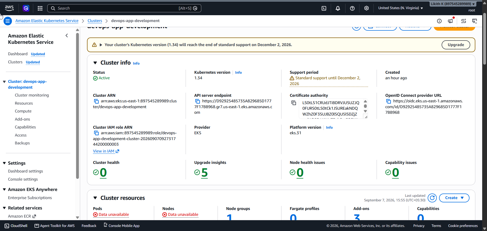
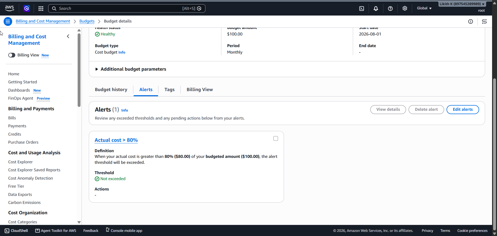
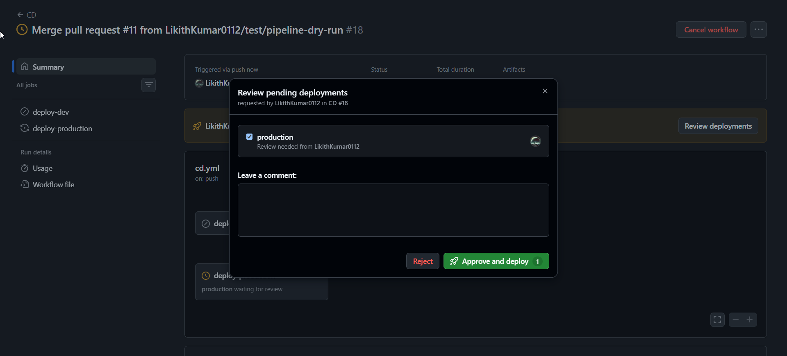
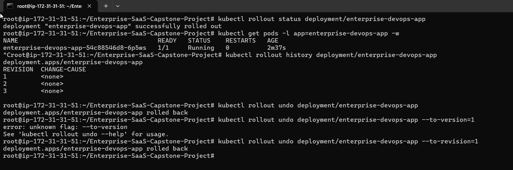
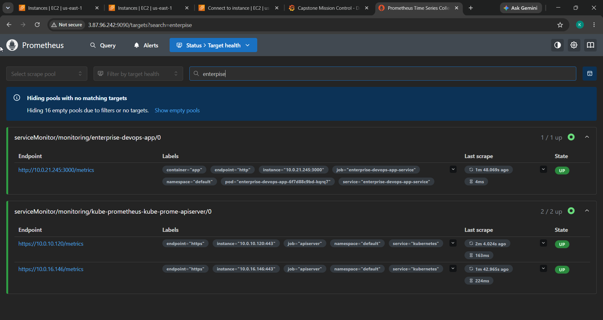
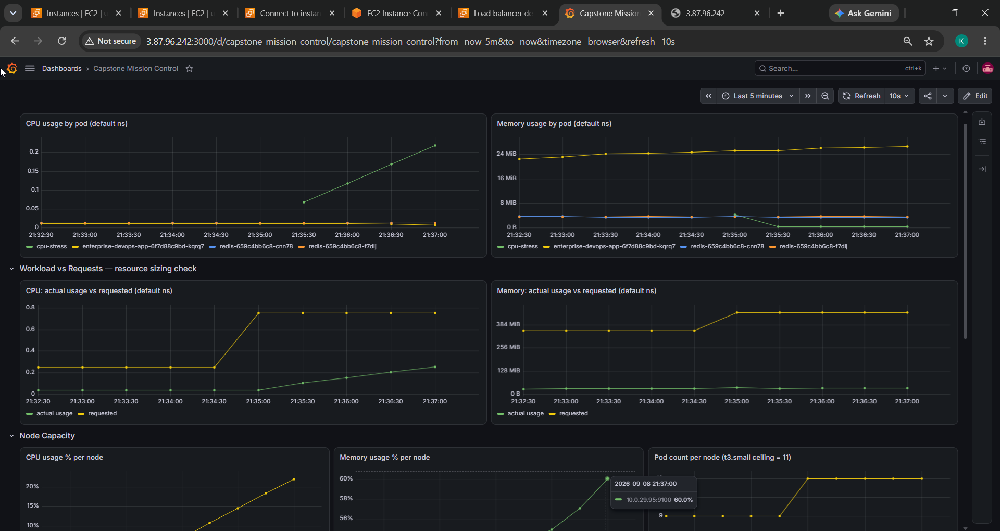
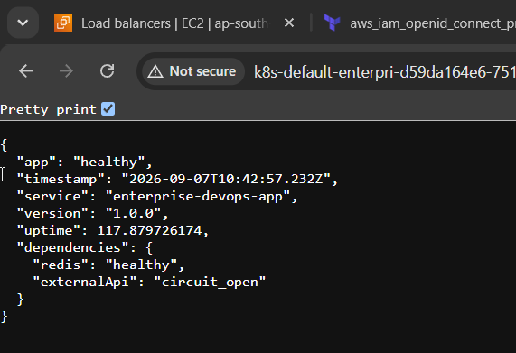
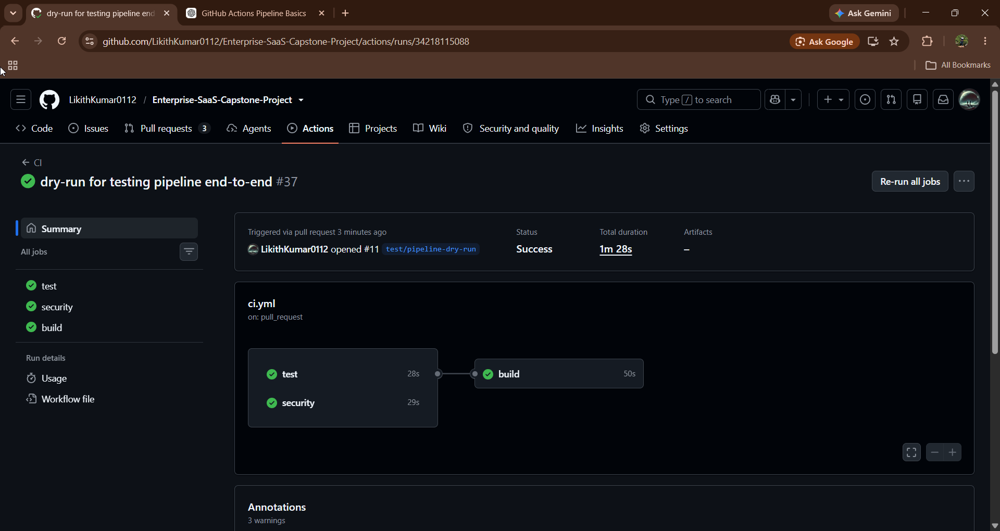
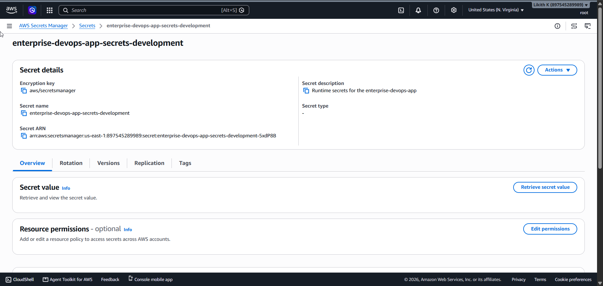
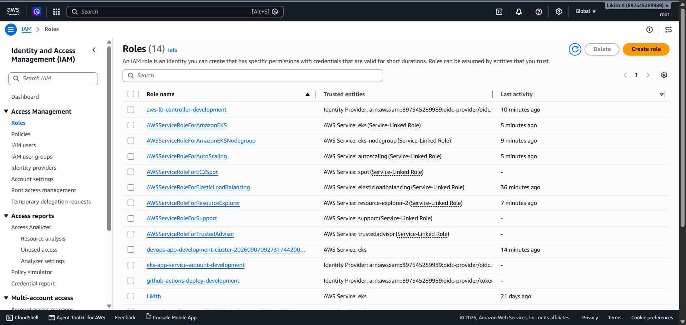

# Review Follow-up: Enterprise SaaS DevOps Capstone

This document responds to the Skillfyme review of the Enterprise SaaS DevOps Capstone Project. It lists
what changed on the `fix/review-followup` branch in response to each review section, how each change was
verified, and what remains open.

## How to read the evidence

**The changes in this document have not been deployed to AWS.** A full redeployment was not repeated
because of its cost and resource requirements, so the changes were verified locally instead.

The screenshots come from the original deployment in September 2026 and are included in the
[evidence section](#evidence-from-the-first-submission). They show the platform as first submitted, not
the changes below.

| Label | Meaning |
|---|---|
| **Tested** | Run locally: automated tests, a real container, or a tool that checks the result |
| **Validated** | Implemented and passes static validation; not run on AWS |
| **Open** | Not done |

## Summary

| Review section | Item | Status |
|---|---|---|
| 1. Testing | Sustained load test reporting p95, p99, throughput and error rate | **Tested** |
| 1. Testing | Redis outage and recovery, circuit-breaker recovery | **Tested** |
| 2. Docker | Generated files removed from git and the build context | **Tested** |
| 2. Docker | Reproducible image: base pinned by digest, no `apk upgrade` | **Tested** |
| 3. Terraform | Bootstrap configuration for the backend and OIDC provider | **Validated** |
| 3. Terraform | Plan files removed and ignored | **Tested** for current files; **Open** for git history |
| 4. Kubernetes | HPA, PDB and NetworkPolicy consolidated into Helm | **Tested** (lint and render) |
| 4. Kubernetes | Highly available Redis through ElastiCache | **Validated** |
| 5. CI/CD | Separate production cluster, ECR repository, values and role | **Validated** |
| 5. CI/CD | Blocking Snyk scan | **Validated** |
| 6. Security | ServiceAccount, IRSA and runtime secret injection | **Tested** with mocked AWS and local Redis AUTH; **Validated** for EKS |
| 7. Observability | Logs shipped to CloudWatch, alarms on real metrics | **Validated** |
| 7. Resilience | Chaos experiments | **Tested** for Redis and API failures; **Open** on EKS |
| 8. Documentation | Docs corrected, checklist tied to evidence | Done |

## Changes by review section

### 1. Application development and testing

- Replaced the fixed-count load test with a k6 test (`app/tests/load/k6-load.js`). It runs sustained load
  and fails if p95 reaches 500 ms, p99 reaches 1 second, or errors reach 1%. It also runs in CI.
- Added `app/tests/integration/resilience.test.js`, which cuts and restores a real Redis connection, and
  takes a circuit breaker through open and back to closed.
- Unit tests need nothing else running, and integration tests need Redis, as separate commands.
- Raised the coverage thresholds.

### 2. Docker

- Removed tracked coverage reports, logs and `junit.xml` from git, and added them to `.gitignore` and
  `.dockerignore`.
- Pinned the base image by digest and removed `apk upgrade`, so the same Dockerfile builds the same
  packages. Dependabot now proposes base image updates.
- Moved from Node 20, which is end-of-life and whose image had OpenSSL findings, to Node 22.

### 3. Terraform

- Added `terraform/bootstrap`, which creates the S3 state bucket, DynamoDB lock table and account-wide
  GitHub OIDC provider.
- Split settings per environment in `terraform/backend/` and `terraform/environments/`.
- Deleted `tfplan_destroy` and `tfplan_lbc`, and changed the ignore rule to `tfplan*`.

### 4. Kubernetes, Helm and high availability

- Replaced two independent Redis pods with an ElastiCache replication group: one node in development, and
  a primary and replica with Multi-AZ and automatic failover in production.
- Moved the HPA, PDB and NetworkPolicy into Helm and deleted the duplicate `k8s/` manifests. The Helm HPA
  now includes the memory metric and scaling behaviour.

### 5. CI/CD

- Production now has its own cluster variable, ECR repository, values file and deploy role, and each role
  can only be assumed from its own GitHub environment.
- A shared `deploy.yml` stops the job if the cluster name doesn't match the environment.
- Removed `continue-on-error` from Snyk, and pinned all actions to exact commits.

### 6. Security, secrets and identity

- The Helm chart now creates the `enterprise-devops-app` ServiceAccount with the IAM role annotation.
- The full flow now exists in code:

  ```
  Secrets Manager → IAM role → IRSA ServiceAccount → app startup → TLS + AUTH → ElastiCache
  ```

- The app role can now only read its own secret; unused ECR and CloudWatch permissions were removed.

### 7. Observability and resilience

- Added the `amazon-cloudwatch-observability` EKS add-on, which ships container logs to
  `/aws/containerinsights/<cluster>/application`. This replaces the unused `/aws/ecs/...` log group.
- Rewrote `docs/chaos-engineering.md` with hypotheses and pass criteria, and added `scripts/chaos-test.sh`
  to measure impact and recovery.

### 8. Documentation

- Corrected the README, architecture, deployment, cost and getting-started docs to match the code.
- Rewrote `docs/production-checklist.md` so each ticked item points at evidence.

## Problems found beyond the review

| Problem | Fix | Status |
|---|---|---|
| Committed plan files in the public repo held Terraform state, including the Redis token | Files removed; the token is regenerated on the next `terraform apply` | History **Open** |
| Automatic rollback could never run, because a failed `helm --wait` skipped the rollback step | `helm upgrade --atomic` in both environments | **Validated** |
| CD deployed without waiting for CI, and CI did not run for `main` | CD runs CI first | **Validated** |
| `/health` hung with Redis down, and returned 429 after 100 requests, failing probes (reproduced on the original code) | `/livez` and `/readyz`, with no dependency checks and no rate limit | **Tested** |
| A Redis outage made the products API return 500 | Serves uncached, with `degraded: true` | **Tested** |
| The rate limiter shared one limit between all users behind the ALB | `TRUST_PROXY_HOPS` | **Validated** |
| Fault-injection and cache endpoints were public | Return 404 in production | **Tested** |
| 1 critical and 2 high vulnerabilities in production dependencies | Upgraded; `npm audit` reports 0 | **Tested** |
| CloudWatch alarms used metrics that weren't published, so stayed at Insufficient Data | Container Insights metrics | **Validated** |
| NetworkPolicy wasn't enforced, and would have blocked DNS and the ALB if it had been | Enforcement enabled, rules corrected | **Validated** |
| The ElastiCache security group referenced the wrong group, so nodes couldn't have connected | Uses the node security group | **Validated** |
| The nightly scan used an invalid runner, `ubuntu:latest` | `ubuntu-latest` | **Tested** with actionlint |
| A `terraform fmt` failure would have stopped the Terraform workflow | Formatted | **Tested** |
| `k8s/cpu-stress.yaml` couldn't trigger the HPA, which measures only the app's pods | Removed in favour of k6 | HPA scaling **Open** |

## Local test results

Run on the final code with Node 22.

| Check | Result |
|---|---|
| Unit tests | 22 passed, coverage above the raised thresholds |
| Integration tests against real Redis | 7 passed |
| k6: 10 users, 2 minutes, final image | 74 req/s, p95 4.50 ms, p99 7.96 ms, 0% errors |
| Final image with read-only filesystem and no capabilities | Starts and serves, using Redis AUTH |
| Same container with Redis stopped | `/livez` 200, `/health` 503, products served with `degraded: true` |
| Trivy on the final image's filesystem | No CRITICAL or HIGH findings |
| `npm audit` (production dependencies) | 0 vulnerabilities |
| ESLint, Hadolint, actionlint, `terraform validate`, `helm lint` | All pass |

The k6 figures come from containers on one host, with no ALB or network path, so they show the test works
and are not production performance numbers.

## Evidence from the first submission

These screenshots are from the September 2026 deployment.

### Still applies to the current design

| Screenshot | Shows |
|---|---|
|  | EKS cluster `devops-app-development`, Active, Kubernetes 1.34 |
|  | $100 budget with an 80% alert, not exceeded |
|  | Manual approval gate on the `production` environment |
|  | Kubernetes rollout history and rollback commands |
|  | The app's ServiceMonitor target UP in Prometheus |

### Superseded by the changes above

These show how the platform worked before the changes, and are included as the starting point.

| Screenshot | Shows | Since changed |
|---|---|---|
|  | App metrics, with two in-cluster Redis pods and the `cpu-stress` pod | Redis is now ElastiCache; `cpu-stress` removed |
|  | `/health` through the ALB | The ALB now checks `/readyz` |
|  | CI `test`, `security` and `build` jobs passing | CI now has a load test and blocking Snyk, and gates CD |
|  | The runtime secret in Secrets Manager | The app now reads it at startup |
|  | App, deploy and controller roles | Role permissions and trust narrowed |

## What remains open

**Not run on AWS.** These need a live deployment to confirm:

- Production deploying to its own cluster and ECR repository, and the rollback path
- IRSA, secret retrieval, and TLS and AUTH to ElastiCache, including failover
- NetworkPolicy enforcement, CloudWatch log shipping, and alarms leaving Insufficient Data
- Load testing and HPA scaling on EKS, and the chaos experiments in `scripts/chaos-test.sh`

**Not implemented:**

- HTTPS on the ALB, which needs a domain and ACM certificate
- Removing the plan files from git history. They remain visible in earlier commits of this public
  repository, so the token they contain should be treated as exposed. Applying Terraform replaces it.

The steps to run this on AWS are in the [Deployment Guide](./deployment/deployment-guide.md).
