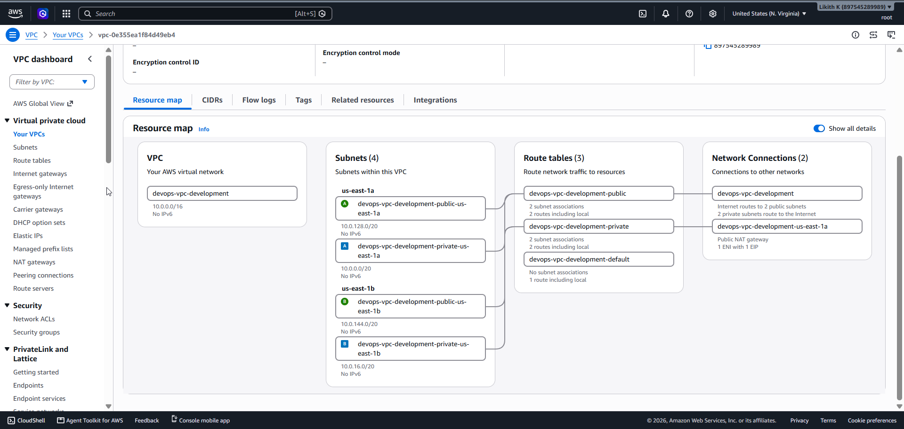
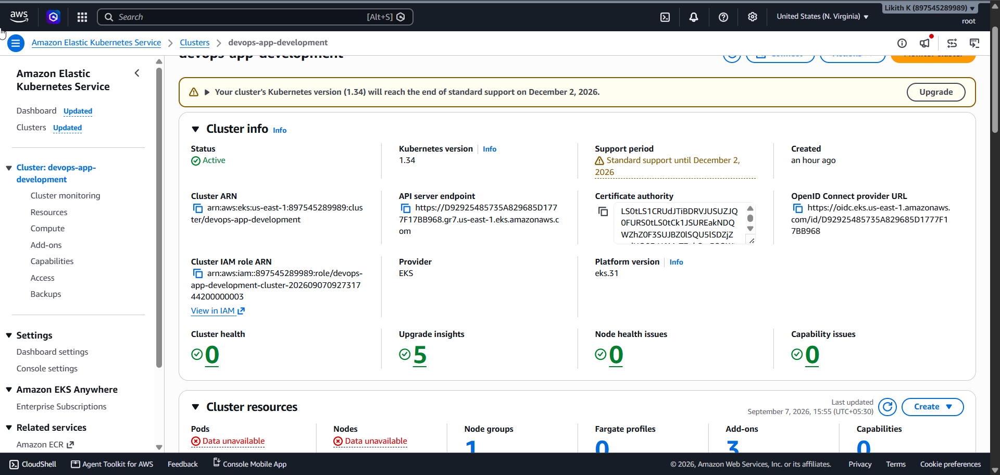
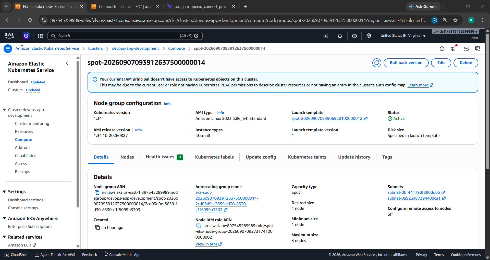
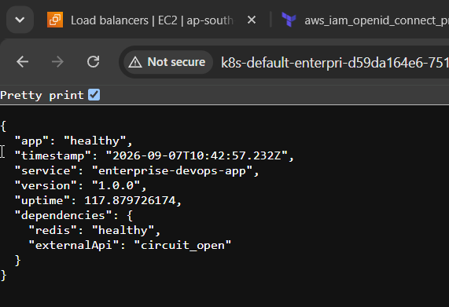
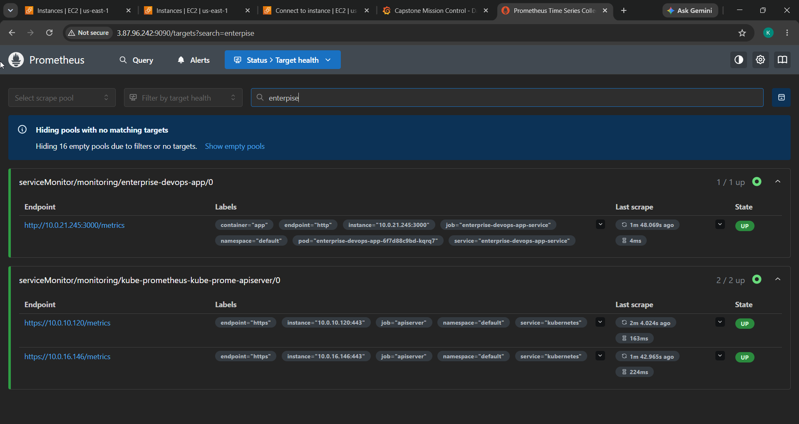
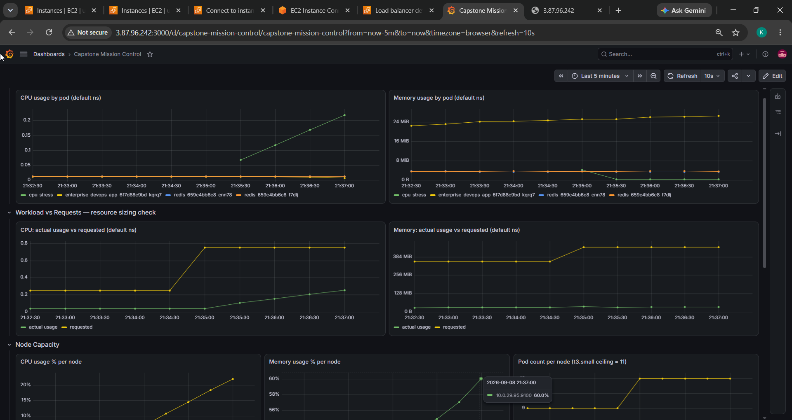
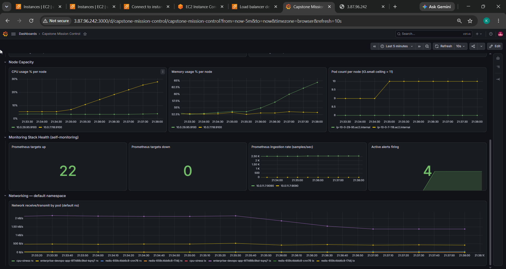
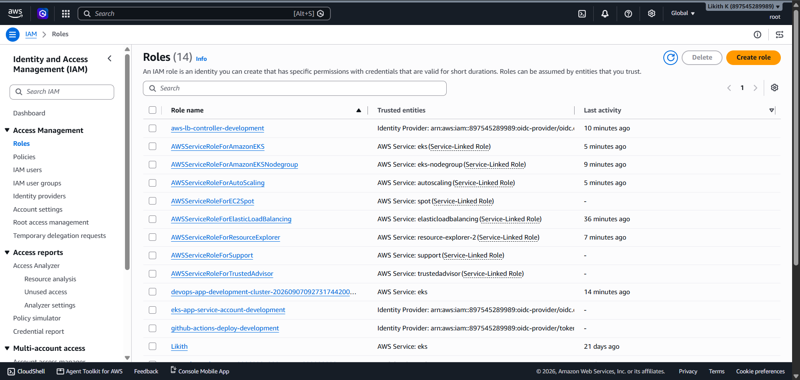
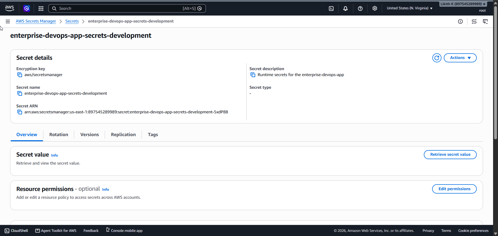

# System Design

This document describes the architecture that is actually provisioned by the
Terraform, Helm, and Kubernetes manifests in this repository, and the reasoning
behind the key decisions.

## High-level overview

```
                          Internet
                              │
                              ▼
              ┌──────────────────────────────┐
              │  Application Load Balancer    │  (internet-facing, created by the
              │  (AWS LB Controller + Ingress)│   AWS Load Balancer Controller)
              └──────────────┬───────────────┘
                             │ target-type: ip → pod IPs
        ┌────────────────────┼────────────────────────────────┐
        │  EKS cluster (Kubernetes 1.34)                       │
        │                                                      │
        │   Ingress ──► Service (ClusterIP :80 → :3000)        │
        │                 │                                    │
        │                 ▼                                    │
        │   Deployment: enterprise-devops-app (2 replicas)     │
        │     • non-root (uid 1001), drop ALL caps             │
        │     • /health probes, /metrics endpoint              │
        │     • HPA (CPU 70%), PDB (minAvailable 1)            │
        │                 │                                    │
        │                 ▼                                    │
        │   In-cluster Redis (Deployment + ClusterIP Service)  │
        │                                                      │
        │   ServiceMonitor ──► kube-prometheus-stack           │
        │     (Prometheus scrape → Grafana dashboards)         │
        └──────────────────────────────────────────────────────┘
                             │
     EKS-managed node group: SPOT t3.small (min 1 / desired 2 / max 3)
                             │
        ┌────────────────────┴────────────────────┐
        │  VPC (10.0.0.0/16), 2 AZs                │
        │  public subnets ──► single NAT gateway   │
        │  private subnets ──► worker nodes        │
        └──────────────────────────────────────────┘
```

## Network — VPC

Provisioned by `terraform/modules/vpc` (wrapping `terraform-aws-modules/vpc`):

- CIDR `10.0.0.0/16` across **two availability zones** (`us-east-1a`, `us-east-1b`).
- Public and private subnets per AZ. Public subnets are tagged
  `kubernetes.io/role/elb` and private subnets `kubernetes.io/role/internal-elb`
  so the AWS Load Balancer Controller can auto-discover where to place load balancers.
- Worker nodes run in the **private** subnets; egress to the internet (ECR pulls,
  package registries, external API calls) goes through a NAT gateway.

**Decision — single NAT gateway.** `single_nat_gateway = true`. A NAT gateway per AZ
would be more highly available, but each one costs roughly $32/month plus data
processing. For a cost-conscious capstone environment a single shared NAT is the right
trade-off (~$64/month saved versus one-per-AZ). The accepted downside is that an AZ
outage taking down the NAT would cut egress for the whole cluster.



## Compute — EKS

Provisioned by `terraform/modules/eks` (wrapping `terraform-aws-modules/eks ~> 20.0`):

- **Kubernetes 1.34**, public API endpoint enabled (no bastion/VPN in this
  environment), IRSA enabled, and the cluster-creator granted admin so `kubectl`
  works immediately after `apply`.
- Core addons managed by EKS: `coredns`, `kube-proxy`, `vpc-cni`. The EBS CSI driver
  is intentionally left out — nothing in the app uses PersistentVolumeClaims, and the
  addon would need its own IRSA role for no benefit here.
- Two separate environments, each with its own cluster, VPC, ECR repository, Redis, IAM roles and
  Terraform state (`terraform/environments/`, `terraform/backend/`):
  - **Development:** **SPOT `t3.small`** nodes, `min_size = 1`, `desired_size = 3`, `max_size = 4`.
  - **Production:** on-demand `t3.medium` nodes, `min_size = 2`, `desired_size = 3`, `max_size = 4`.

**Decision — SPOT instances in development.** `capacity_type = "SPOT"` gives roughly 70% off
on-demand pricing, and the workload is stateless.

**Decision — three `t3.small` nodes in development.** A single `t3.small` can only run
about 11 pods (the ENI/IP limit imposed by the AWS VPC CNI). The kube-prometheus-stack, the
LB controller and the CloudWatch add-on's agents need more than two nodes provide, with room left
for rolling updates. See
[troubleshooting](../troubleshooting/common-issues.md) for the symptom this fixed.





## Ingress & load balancing

The app's Helm chart (`helm/saas-app`) defines an `Ingress` with `ingressClassName: alb`
and annotations:

- `alb.ingress.kubernetes.io/scheme: internet-facing`
- `alb.ingress.kubernetes.io/target-type: ip` — the ALB targets pod IPs directly
- `alb.ingress.kubernetes.io/healthcheck-path: /readyz`
- `/metrics` returns 404 at the ALB; Prometheus scrapes it from inside the cluster

The **AWS Load Balancer Controller** (installed via Helm, backed by an IRSA role from
`terraform/lb-controller-irsa.tf`) watches this Ingress and creates/updates the real
ALB, target groups, and health checks in AWS. The controller's ability to create AWS
resources is why teardown has to delete the Ingress *before* `terraform destroy` — see
troubleshooting.

The Service in front of the Deployment is a plain `ClusterIP` (`:80 → :3000`).

The ALB target group registers the pod IPs and health-checks them on `/readyz`.

Hitting the ALB DNS name returns the app's health payload (Redis healthy; the external
API dependency shown with its circuit breaker open):



## Container security posture

The Helm Deployment enforces a **restricted** PodSecurity posture:

- `runAsNonRoot: true`, `runAsUser: 1001`, `fsGroup: 1001`
- `allowPrivilegeEscalation: false`, `readOnlyRootFilesystem: true`
- `capabilities: drop: ["ALL"]`
- `seccompProfile: type: RuntimeDefault`

The Docker image (`app/src/Dockerfile`) reinforces this: a multi-stage build that runs
as UID 1001, pins its base image by digest, strips npm/npx/corepack out of the runtime layer to shrink the CVE surface,
and uses `dumb-init` as PID 1.

**Decision — restricted PodSecurity.** Running as a locked-down non-root user with no
Linux capabilities is the baseline required to pass the Trivy image scan (which fails CI
on CRITICAL/HIGH) and to satisfy the `restricted` Pod Security Standard. A `NetworkPolicy`
(in the Helm chart, enforced by enabling it on the VPC CNI add-on) limits inbound traffic to the ALB
and the monitoring namespace on the app port, and outbound traffic to DNS, Redis and 80/443 with the
instance metadata endpoint blocked.

**Application hardening.** Fault-injection and cache endpoints return 404 when `NODE_ENV=production`.
The rate limiter uses the real client IP behind the ALB (`TRUST_PROXY_HOPS=1`).

`docker exec … whoami` confirms the container process runs as the non-root `nodejs` user:


## Data — Redis

Redis is **Amazon ElastiCache** (`aws_elasticache_replication_group` in `terraform/main.tf`), with TLS
in transit, encryption at rest and an auth token:

- **Development:** one node. It proves the same security path but has no failover.
- **Production:** primary and replica across two AZs, with Multi-AZ and automatic failover.

**Decision — ElastiCache instead of in-cluster Redis.** Two independent Redis pods behind one Service
give each request a different cache and no failover. Managed Redis gives real replication at about
$12 per node per month, and only while the environment is running.

**Decision — Redis is a cache, not a hard dependency.** While it is unavailable the app keeps serving,
uncached, with `degraded: true` in the response, and reconnects automatically. Probes don't check
Redis, so an outage can't restart pods or remove them from the ALB. `/health` still reports it.

## Observability

`monitoring/servicemonitor.yaml` defines a `ServiceMonitor` (in the `monitoring`
namespace, labelled `release: kube-prometheus`) that selects the app Service and scrapes
its `/metrics` endpoint every 15s. The app exposes Prometheus metrics via `prom-client`
(default process metrics plus `http_requests_total` and `http_request_duration_seconds`).
The **kube-prometheus-stack** provides Prometheus (scraping) and Grafana (dashboards);
The `amazon-cloudwatch-observability` EKS add-on (`terraform/observability.tf`) provides Container
Insights metrics and ships container stdout through Fluent Bit to
`/aws/containerinsights/<cluster>/application`. Two alarms on those metrics (`node_cpu_utilization`,
`node_memory_utilization`) notify an SNS topic.



Grafana visualises the scraped metrics — per-pod CPU/memory and request-vs-limit sizing:



…and cluster health, including node capacity, pod-count-per-node (against the ~11-pod
`t3.small` ceiling), Prometheus targets up, and active alerts:



### Autoscaling & self-healing

The `HorizontalPodAutoscaler` targets 70% CPU and 80% memory of the app's own pods, so scaling is
driven by traffic to the app, such as the k6 load test (`app/tests/load/k6-load.js`).

Probes use `/livez` and `/readyz`, which check no dependencies. On shutdown, the app fails readiness,
waits for traffic to drain, finishes in-flight requests and then exits.

## Secrets & identity

- **GitHub Actions → AWS** authenticates via **OIDC** (`terraform/oidc.tf`); no
  long-lived AWS keys are stored in GitHub. Each environment has its own deploy role, which can be
  assumed only from that GitHub environment and can push only to that environment's ECR repository.
  The development role can also be assumed by pull requests, for `terraform plan`.
- **App → AWS** uses **IRSA**: the Helm chart creates the `enterprise-devops-app` ServiceAccount with
  the role annotation, and that role can only read its own Secrets Manager secret.
- **Redis auth:** Terraform generates the token (`random_password`), sets it on ElastiCache and stores
  it in **AWS Secrets Manager**. At startup, `app/src/secrets.js` reads it with the IRSA credentials
  and passes it to the Redis client. The app refuses to start if it can't read the secret. The token is
  not in the image, Helm values or Kubernetes objects.

```
Secrets Manager → IAM role → IRSA ServiceAccount → app startup → TLS + AUTH → ElastiCache
```

The IAM roles backing IRSA and the GitHub OIDC deploy role:



The app's runtime secret in AWS Secrets Manager:



## Related documents

- [Deployment Guide](../deployment/deployment-guide.md)
- [Getting Started](../development/getting-started.md)
- [Troubleshooting](../troubleshooting/common-issues.md)
- [Cost Optimization Report](../cost-optimization-report.md)
