# Deployment Guide

This describes how the application is actually deployed to EKS — both the automated
CI/CD path and how to deploy or roll back manually.

## CI/CD overview

Workflows in `.github/workflows/`:

- **`ci.yml`** runs on PRs to `main`/`develop`, and is called by `cd.yml`. It lints, runs unit
  and integration tests against a `redis:7-alpine` service container, runs a k6 load test with
  latency and error thresholds, runs a blocking Snyk scan, builds the image, and scans it with
  Trivy (fails on CRITICAL/HIGH) and Hadolint.
- **`cd.yml`** runs on pushes to `develop` and `main`. It runs all of CI first, so a failed test
  or scan stops the deployment.
- **`deploy.yml`** is the deployment job, shared by both environments so they can't drift apart.

```
push to develop ──► CI ──► deploy (development cluster, development ECR)
push to main ─────► CI ──►[approval]──► deploy (production cluster, production ECR)
```

The CI workflow (`test` → `build`, with `security` in parallel) passing on a PR:

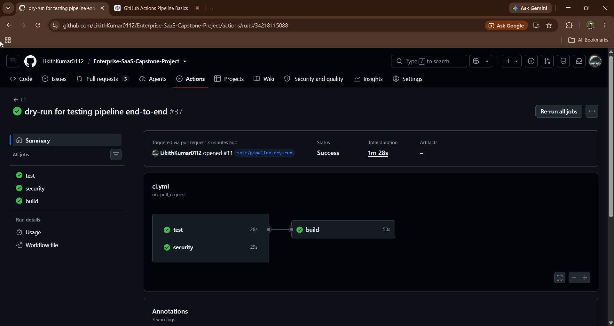

CI green on the PR into `develop`:

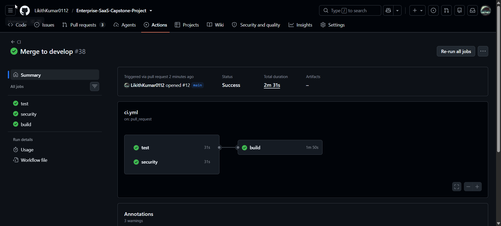

### Secret scanning (pre-commit)

Beyond the pipeline, `gitleaks` is wired into `.pre-commit-config.yaml` (alongside
`terraform_fmt`/`tflint`/`tfsec`) so secrets are caught before they're ever committed:

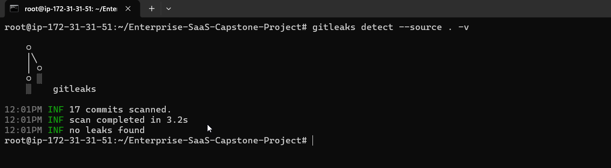

## How the CD pipeline deploys

Each environment's deployment (`deploy.yml`):

1. **Checks the configuration.** The job stops if the cluster variable is empty, or names a
   different environment.
2. **Assumes that environment's AWS role via OIDC.** No static AWS keys are stored in GitHub. The
   production role can only be assumed from the GitHub `production` environment, and can only push to
   the production ECR repository.
3. **Logs in to ECR, builds and pushes the image**, tagged with the commit SHA. If a re-run finds
   that tag already exists, it reuses the image, because tags are immutable. Images are governed by
   the lifecycle policy (untagged expire after 7 days, last 30 kept).

   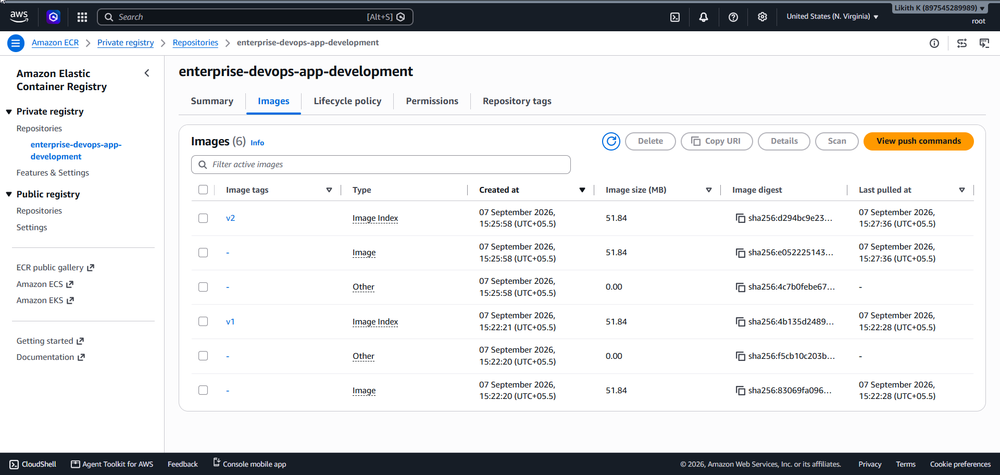
4. **Deploys with `helm upgrade --install --atomic`**, using that environment's values file. If the
   rollout doesn't become healthy within 5 minutes, Helm rolls back automatically.
5. **Runs a smoke test** through a port-forward: `/readyz`, `/health` (which needs a working Redis
   connection, so it also proves the secret and network path) and the products API. If it fails, the
   job runs `helm rollback` and fails.

### Production

A push to `main` runs CI, then **pauses for manual approval** through the GitHub `production`
environment's required reviewer:

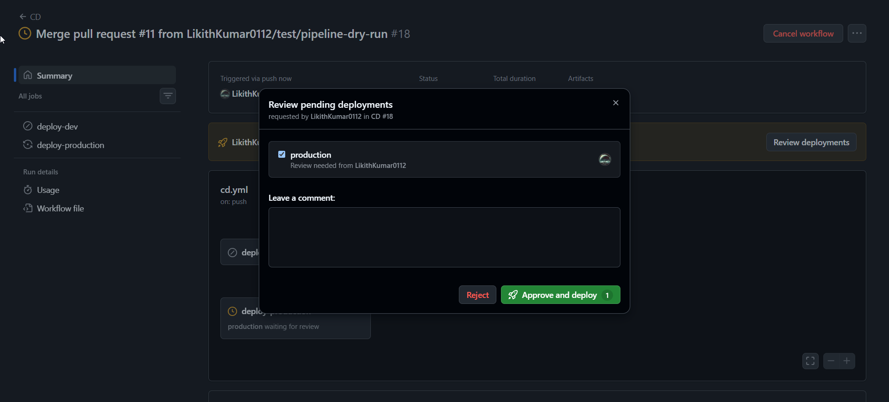

### GitHub configuration

| Name | Kind | Scope | Value |
|---|---|---|---|
| `AWS_DEPLOY_ROLE_ARN` | Secret | Repository | `github_deploy_role_arn` output from development |
| `AWS_DEPLOY_ROLE_ARN` | Secret | `production` environment | `github_deploy_role_arn` output from production |
| `SNYK_TOKEN` | Secret | Repository | Snyk API token; CI fails without it |
| `AWS_REGION` | Variable | Repository | `us-east-1` |
| `EKS_CLUSTER_NAME_DEV` | Variable | Repository | `devops-app-development` |
| `EKS_CLUSTER_NAME_PROD` | Variable | Repository | `devops-app-production` |
| `ALERT_EMAIL` | Variable | Repository | Address for alarm and budget emails |

## Prerequisites for a manual deploy

- `aws`, `kubectl`, and `helm` installed and on `PATH`
- AWS credentials with access to the cluster (the CI deploy role, or your own admin)
- kubeconfig pointed at the cluster:

  ```bash
  aws eks update-kubeconfig --name devops-app-development --region us-east-1
  ```

## Manual deploy

Deploy a specific image tag (a commit SHA that exists in ECR). Run this from `terraform/`, initialized
for the same environment. For production, use `values-prod.yaml`:

```bash
helm upgrade --install saas-app ../helm/saas-app -n default \
  -f ../helm/saas-app/values-dev.yaml \
  --set image.repository=$(terraform output -raw ecr_repository_url) \
  --set image.tag=<commit-sha> \
  --set serviceAccount.roleArn=$(terraform output -raw app_role_arn) \
  --set env.REDIS_URL=rediss://$(terraform output -raw redis_endpoint):6379 \
  --set env.AWS_REGION=us-east-1 \
  --atomic --timeout 5m
```

A manual `helm upgrade` bumping the image to `v3` — Helm reports the release upgraded to
revision 3:

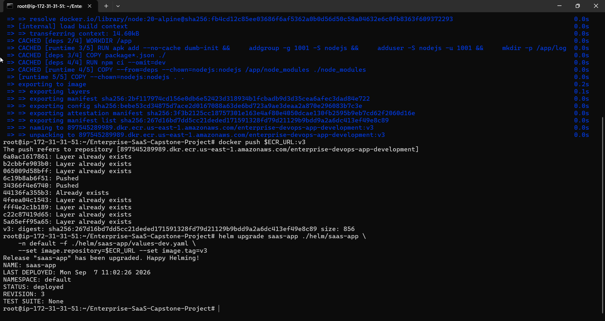

Because the Deployment uses a rolling update, the ALB keeps serving throughout — the app
responds with the new `v3` build and zero downtime:

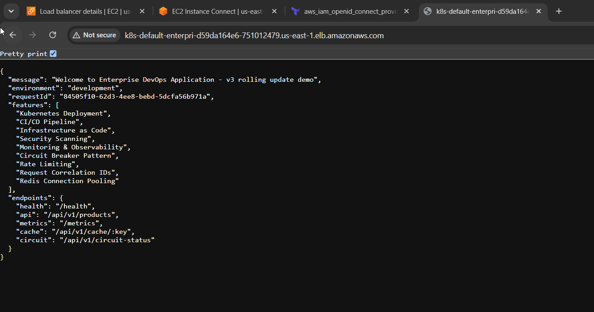

## Provisioning the infrastructure

Once per AWS account, apply [`terraform/bootstrap`](../../terraform/bootstrap/README.md). It creates
the S3 state bucket, the DynamoDB lock table and the GitHub OIDC provider. Then provision each
environment, which also installs the AWS Load Balancer Controller:

```bash
export TF_VAR_alert_email=you@example.com
./scripts/bootstrap.sh development
./scripts/bootstrap.sh production
```

Infrastructure is provisioned with Terraform (S3-backed remote state). `terraform plan`
shows the full set of resources to be created:

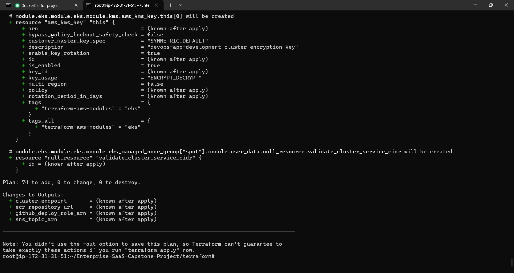

`terraform apply` reconciles the stack (here reporting no drift):

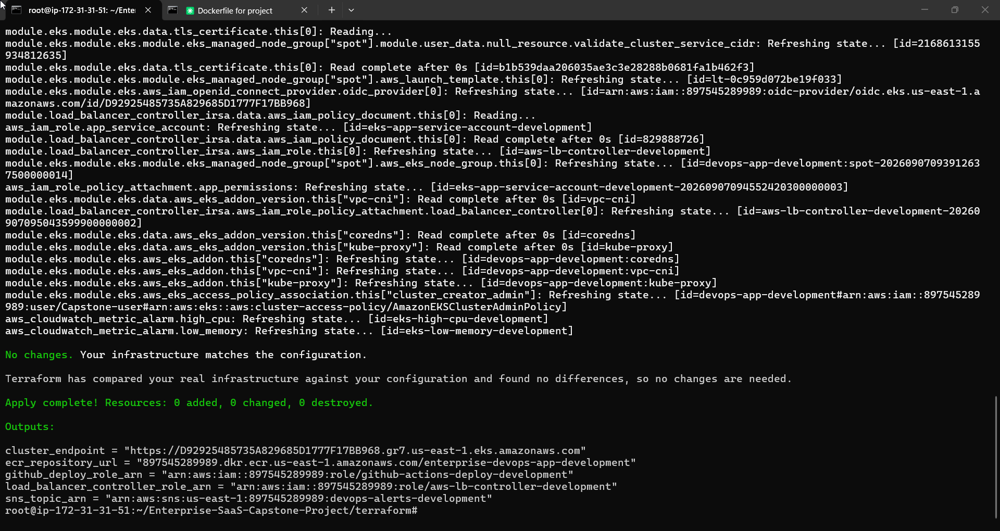

State is stored remotely in S3 (locked via DynamoDB), not on the local disk:

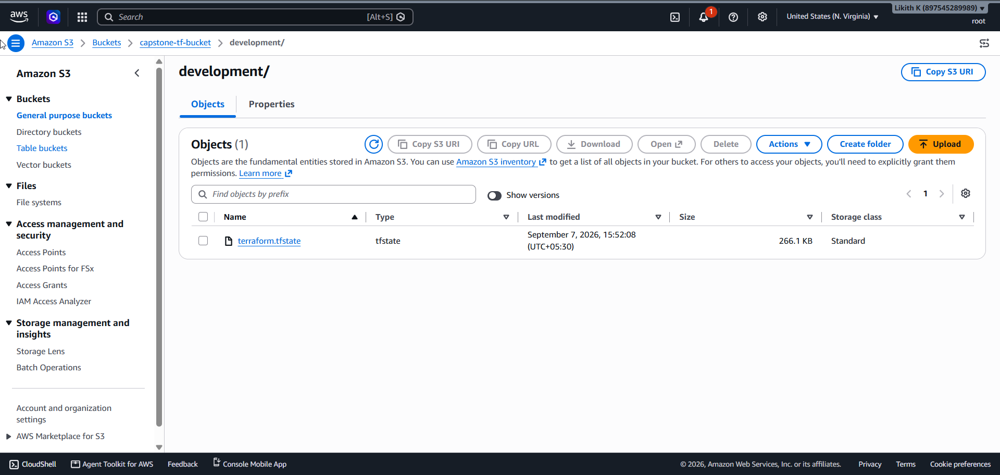

## Verifying a deploy

```bash
kubectl rollout status deployment/enterprise-devops-app -n default
kubectl get pods,svc,ingress,hpa -n default
helm history saas-app -n default
```

The `ADDRESS` on the Ingress is the ALB DNS name; `curl http://<alb-dns>/health` should
return healthy.

See [Chaos Experiments](../chaos-engineering.md) for failure testing.

## Rolling back

Helm keeps release history, so rollback is one command:

```bash
helm history saas-app -n default          # find the last good REVISION
helm rollback saas-app <revision> -n default
# or roll back to the immediately previous release:
helm rollback saas-app -n default
```

The CD pipeline runs this automatically if the smoke test fails. If the rollout itself fails,
`--atomic` rolls back without it.

`kubectl rollout history` / `rollout undo` achieve the same at the Deployment level
(note `--to-revision` is the correct flag, not `--to-version`):

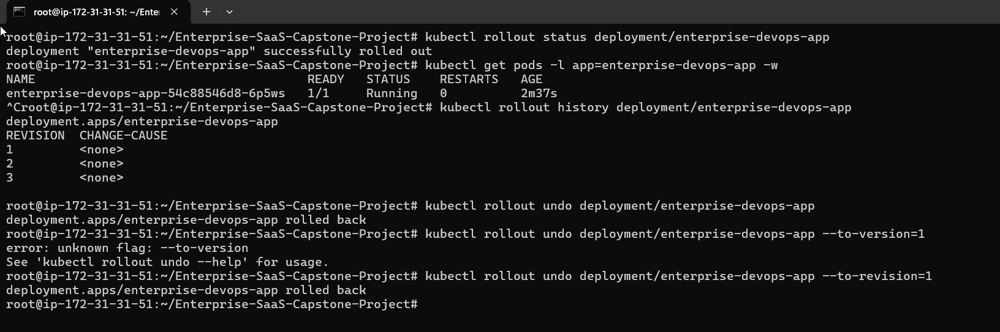

## Teardown

To destroy an environment's billable infrastructure, use the teardown script. It removes
the app first, so the AWS Load Balancer Controller deletes the ALB before Terraform tries
to delete the VPC:

```bash
TF_VAR_alert_email=you@example.com ./scripts/teardown.sh production
```

## Related documents

- [System Design](../architecture/system-design.md)
- [Branching Strategy](../branching-strategy.md)
- [Troubleshooting](../troubleshooting/common-issues.md)
